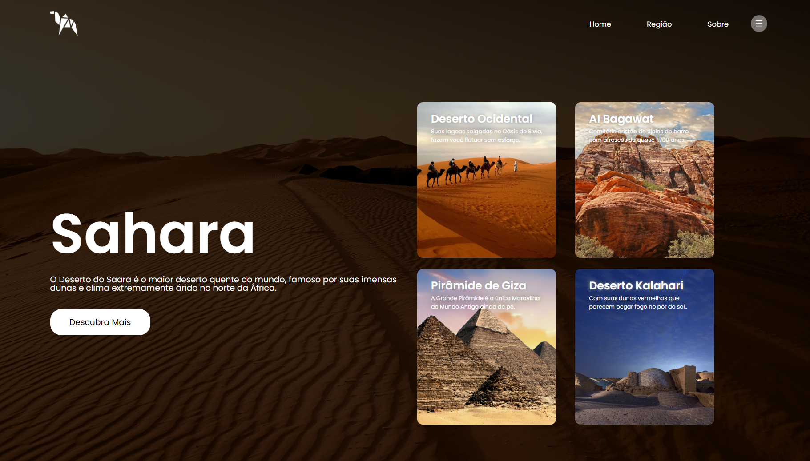

# 🏜️ Regiões Pelo Mundo — Landing Page de Viagens

Projeto de uma landing page com temática de viagens e exploração geográfica, desenvolvido com **HTML5 e CSS3** como parte de uma atividade prática do curso PROA.

O projeto tem como objetivo explorar a criação de interfaces visuais para sites de turismo, utilizando imagens de destinos, organização de conteúdo em colunas, cartões informativos e efeitos de interação com CSS.

## 🖥️ Prévia do projeto

  

🔗 **[Acesse o projeto online](https://gabrielc0liveira.github.io/Projeto26Proa-RegioesPeloMundo/)**

## Funcionalidades e características

- Landing page com temática de viagens e exploração geográfica.
- Interface inspirada nas paisagens do Deserto do Saara.
- Imagem de fundo com sobreposição escura para destacar o conteúdo.
- Cabeçalho com logotipo, menu de navegação e ícone de menu.
- Seção principal com título, descrição e botão "Descubra Mais".
- Quatro cartões informativos com imagens e descrições de destinos.
- Layout organizado em duas colunas utilizando Flexbox.
- Efeitos de elevação e transições suaves nos cartões ao passar o mouse.

## Tecnologias utilizadas

- **HTML5:** estruturação da página, menu de navegação e cartões informativos.
- **CSS3:** estilização, posicionamento, imagens de fundo e efeitos visuais.
- **Flexbox:** organização do cabeçalho e distribuição do conteúdo em colunas.
- **Google Fonts:** utilização da fonte Poppins.

## Aprendizados

Durante o desenvolvimento, foram praticados conceitos como:

- Estruturação de uma landing page com HTML e CSS.
- Organização de layouts utilizando Flexbox e `flex-basis`.
- Aplicação de imagens de fundo com `background-image` e `background-size`.
- Criação de sobreposições escuras utilizando `linear-gradient`.
- Desenvolvimento e estilização de cartões informativos.
- Criação de efeitos de interação com `:hover` e `transform: translateY()`.
- Aplicação de transições suaves utilizando `transition`.
- Personalização de espaçamentos, bordas e tipografia.

## 📂 Como executar o projeto

🔗 **[Acesse o projeto online](https://gabrielc0liveira.github.io/Projeto26Proa-RegioesPeloMundo/)**

---

Desenvolvido por **Gabriel Oliveira** como parte das atividades práticas do PROA.
